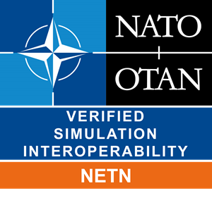
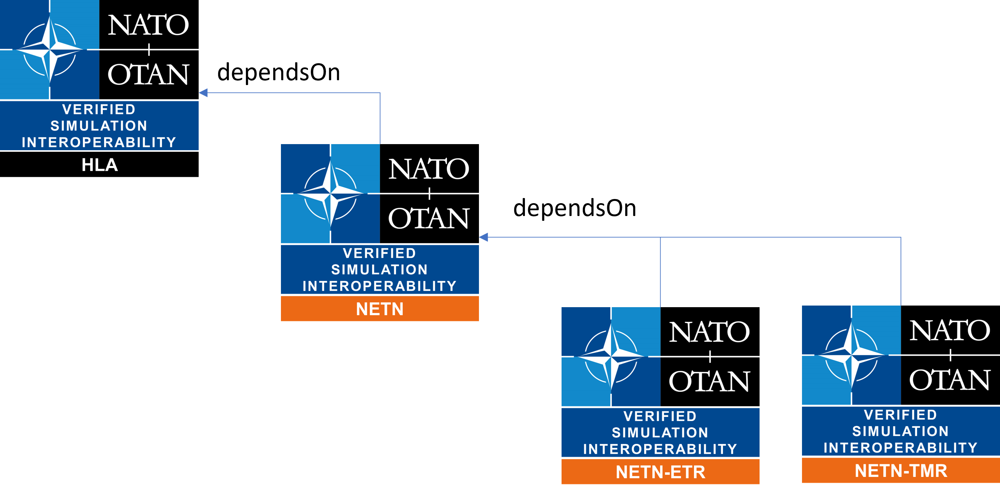

# Experimental NETN Test Suite

This repository will be used for the development of the NETN Test Suite. Currently it contains ETR test cases for SuT in tasker and task receiver roles.



## IVCT Compliance

The current test suite design uses the ServiceLoader interface feature of the IVCT framework. This is only available in the latest snapshot releases and not yet included in the production release. 

## NETN FOM

This test suite verify the NATO Education and Training Network (NETN) Federation Object Model (FOM). 
See also https://github.com/AMSP-04/NETN-FOM

## Test Suite Structure

The test suites modules are aligned to the badge structure. 



## Testing with Booster or local RTI

Booster Config for PITIS-223 Test Environment:
- crc.PITIS-223@localhost:8688

local pRTI
- localhost:8989

These settings may be set via the SettingsDesignator setter of the test case object ("_tc_"), like 

    tc.setSettingsDesignator("crcAddress=localhost:8989");

or via the LRC.settings within the pRTI installation setup.

## Testing without IVCT

There is the possiblity to run the test cases on command line with gradle. There are two test cases ETR_0001 (SuT in role task receiver) and ETR_0002 (SuT in role tasker). To run a dedicated test case TC use the following command:

./gradlew :NETN-ETR:test --tests "org.nato.netn.etr.NetnEtrTestSuiteTest.[TC]", where the method TC can be one of

| TC | Description |
| --- | --- |
| testETR_0001atLocalhost | test case ETR_0001 with local RTI |
| testETR_0001atPITIS223 | test case ETR_0001 with PITIS connection set |
| testETR_0002atLocalhost | test case ETR_0002 with local RTI |
| testETR_0002atPITIS223 | test case ETR_0002 with PITIS connection |

## Test Case Configuration
There is one single configuration file TcParam.json in NETN-ETR/src/main/resources for both test cases:

```json
{
    "federationName" : "NETN4",
    "sutFederateName" : "Pitch Actors",
    "supportedActions" : ["MoveByRoute"],
    "publishedTasks" : ["MoveByRoute", "MoveToLocation"],
    "subscribedReports" : ["ObservationReport", "PositionStatusReport"],
    "taskId" : "77e004e5-a3b3-43be-b655-0f9167ec051b",
    "speed" : 88,
    "route" : [{"x": 58.38580, "y" : 15.55502}, {"x" : 58.37753, "y" : 15.56698}],
    "selfTest" : true,
    "cancelTask" : false
}
```

## LICENCE

Copyright 2025 NATO/OTAN

Licensed under the Apache License, [Version 2.0](http://www.apache.org/licenses/LICENSE-2.0)
